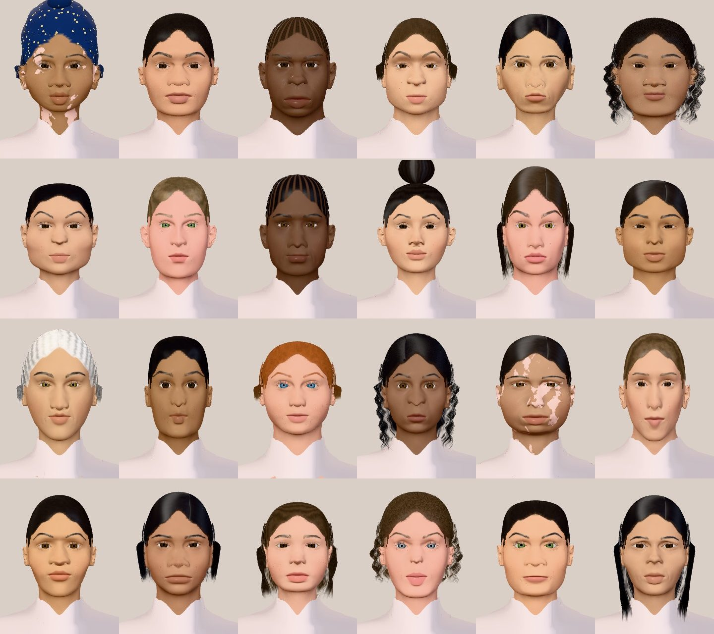

# Generated faces: graphics and diversity system

Status: **prototype, locally verified**. It renders generated faces in the browser and passes the face audit and
render smoke test listed below. It does not yet include makeup painting, the game screens, saves, ads or the
YouTube adapter. Hair and clothing are procedural placeholders that work for every face, but they need an art pass
before release (see "Known limits").



## Owner decisions this implements (18 October 2026)

| Decision | Value |
| --- | --- |
| Engine | Three.js (WebGL), the same engine Haircut uses. No Unity or Godot web build. |
| Presentation | One 3D head, seen by a fixed front camera ("2.5D"). There is no orbit control. A hidden debug orbit exists in the preview only. |
| Base asset | MakeHuman's CC0 base mesh and shape targets, at a pinned commit. No paid scans, no non-commercial academic models (FLAME, BFM, SMPL-X), no MetaHuman, no AI-generated or photographed faces. |
| Diversity | Ancestry profiles are tendencies over individual feature controls, never "race buttons". Individual variation is larger than any profile offset. Cultural choices (head coverings, braids, dyed hair) are style choices offered to everyone. |
| Age | Young adults only (18–30). |
| Textures | Procedural shaders, with no shipped photo textures. |

## Pipeline

```
MakeHuman (CC0, pinned commit)      tools/makehuman/fetch.mjs        sparse git checkout into .cache/
  base.obj + 230 .target files    ─ tools/makehuman/build-head.mjs ─▶ assets/head.bin (committed, reproducible)
                                                                     │
src/face/generator.js  seed ──▶ face record (plain JSON)            │
src/face/queue.js      variety director over seeds                  ▼
src/face/face-view.js  record ─▶ morph ─▶ subdivide ─▶ skin, eyes, brows, lashes, hair, cape ─▶ WebGL
```

### Head asset (`assets/head.bin`)

- The head and shoulders of MakeHuman's hm08 base mesh: 4,478 vertices and 4,452 quads, plus eye and lash
  helper geometry. Its reference shape is a 25-year-old blend of MakeHuman's female macro targets, with the three
  ethnic macro targets weighted equally.
- 93 **shape dimensions** (`tools/makehuman/dims.mjs`). Each one is a signed value in [-1, 1] mapped to MakeHuman's
  `incr`/`decr` targets, with left and right merged into one symmetric dimension. The dimensions cover face
  outline, forehead, brows, eye size, spacing, tilt and lids (epicanthic fold, lid crease, hooding), nose (about 20
  controls), lips (about 20 controls), cheeks, chin, jaw, neck and ears. Each dimension's whole-head translation is
  stored separately and removed at runtime, so faces change shape without moving out of the camera framing.
- **Face-first UV layout.** The islands are rotated upright and packed. The face and scalp island gets most of the
  texture, and the eye sockets and inside of the mouth are packed small. Makeup painting will use this layout
  (`uPaint` in the skin shader).
- **Feature regions per vertex.** These are geodesic distance from the lip line and from the lid margins, plus
  masks for cheeks, under-eye, nose, ears and lips taken from the matching targets. Natural features use them, and
  painting can use them later.
- **Landmarks.** The asset stores eye centres and the lip outline. The vermilion (lip-colour) border is evaluated
  per pixel, so it stays crisp on every face.
- Size: 1,193,728 bytes, 446 KB gzipped. Building twice gives byte-identical output.

### Rendering (`src/face/`)

| Module | What it does |
| --- | --- |
| `head-data.js`, `subdivide.js`, `head-geometry.js` | Parse the asset, apply shape dimensions, run one Catmull-Clark subdivision step, and compute normals and a cavity term (cheap occlusion in creases) |
| `skin-material.js` | Wrapped diffuse with a red shift (a subsurface stand-in) and two specular lobes. Per pixel: natural lips, flush, under-eye tone, freckles, beauty marks, vitiligo, brow fill, a painted hairline, pores, and the `uPaint` hook for makeup |
| `eyes.js` | Eyeballs placed from MakeHuman's eye helpers and aimed at the camera. Procedural iris, set per eye (ready for contact lenses) |
| `brows.js`, `lashes.js`, `strands.js` | Individual brow hairs rooted on the skin, and upper and lower lashes rooted on MakeHuman's lash helper lines. Each lash keeps its own parameters, ready for mascara |
| `hair.js`, `hair-material.js` | Procedural hairstyles and head coverings built from the morphed head (see below), plus the makeup cape |
| `lighting.js` | One fixed "makeup station" light rig shared by every material |

### Generator (`src/face/generator.js`, `profiles.js`, `hair-styles.js`, `colors.js`)

A face record holds every resolved value. It is versioned (`GENERATOR_VERSION`) and fully deterministic from its
seed, so a save can store the record or just `{version, seed}`.

- **Origin.**
  - 62% of faces come from a single profile. There are 16 profiles: West African; East African; Southern and
    Central African; North African and Middle Eastern; Mediterranean European; Northern European; South Asian;
    East Asian; Southeast Asian; Central Asian; Indigenous Americas; Pacific Islander; Melanesian; Aboriginal
    Australian; Arctic Indigenous.
  - 22% are named blends: Latin American, Afro-Caribbean, Afro-Latin, South African Coloured, Central Asian ×
    European, Arab × East African, East Asian × European, South Asian × European.
  - 16% are free two-profile mixes.
  - Profiles are drawn evenly rather than by world population, so every session meets a wide range of people.
- **Shape.** Each dimension gets the weighted profile mean (capped at |0.5|) plus individual variation (standard
  deviation around 0.28), clamped to ±0.9. Each face also gets one or two face-outline blends.
- **Skin.**
  - Tone is a continuous ramp that extends Haircut's ten anchor tones, with five undertones.
  - Freckles depend on fairness and red hair.
  - Rates: beauty marks 49%, vitiligo 2%, albinism about 1% (pale skin, hair, brows, lashes and iris whatever the
    ancestry).
- **Eyes, brows, lashes.** Iris colour comes from the profile. Brows use five shapes with varied thickness, density
  and colour (derived from natural hair colour). Lash length, density and curl vary.
- **Hair.**
  - The profile sets natural texture (straight, wavy, curly, coily) and natural colour.
  - The style is then drawn only from styles that suit that texture, weighted by presentation.
  - Hijab and head wrap are offered to every face at the same rate.
  - 8% of faces have dyed hair and 9% have highlights.
- **Presentation.** 80% feminine, 14% androgynous, 6% masculine (an engineering default in `TRAITS`). Makeup tools
  work the same on every face.
- **Labels.** Profile ids are internal. Players never see them, and they never decide tools, colours, difficulty,
  scores or a "suggested look". The dev preview shows them for review only.

### Variety director (`src/face/queue.js`)

This picks each next face from up to 8 deterministic candidates. It scores each candidate against the last four
faces on origin, hairstyle, skin-tone band, hair colour, presentation, iris and brow shape. Its state is
`{version, cursor, recent}` and survives a JSON save. It never stalls: after 8 candidates it takes the most
different one.

## Hairstyles and head coverings

22 styles are built procedurally around each morphed head:

- Long straight, long wavy, silk press, lob, bob and pixie
- Curly long and curly shoulder-length
- Afro, afro puffs and short natural (TWA)
- Box braids, locs and cornrows
- High ponytail, low bun and top knot
- Short crop, curly top and buzz
- Hijab and head wrap (plain, print or striped cloth)

Building blocks:

- **Cap.** A scalp layer follows a hairline (forehead, temples, sideburns, around the ears, nape) that varies per
  face. The skin shader also paints fine hairs under it, so the hairline is soft.
- **Drape.** Long hair slides down the head and falls in front of or behind the shoulders, without entering the
  face.
- **Hood.** A rounded volume (afro, head wrap) that rolls back onto the scalp at the hairline instead of
  overhanging the face.
- **Balls and tubes** for buns, puffs, braids and locs.
- **Cloth** for the hijab: a face opening, falling from the chin to the shoulders.
- **Cape:** a makeup cape covers the shoulders and the edge of the body mesh.

## Commands

```sh
npm ci
node tools/makehuman/fetch.mjs          # only needed to rebuild the head asset
node tools/makehuman/build-head.mjs     # rebuilds assets/head.bin (byte-identical)
node tools/build-preview.mjs            # build/preview; serve with: node tools/serve.mjs build/preview
node tests/unit.mjs                     # asset, generator and queue checks
node tests/face-audit.mjs 2000 300      # writes docs/FACE-AUDIT.md and docs/face-audit.json
node tests/render-smoke.mjs [--gallery] # Chromium WebGL render check; --gallery rewrites docs/face-gallery.jpg
```

Open `http://localhost:8130/` after `node tools/serve.mjs build/preview` and use Next / Back or the arrow keys.
`?sheet&n=24&cols=6&label` shows a contact sheet with labels.

## Measured (local, headless Chromium with SwiftShader software WebGL)

- Building a face (morph, subdivision, brows, lashes, hair, cape) takes about 70 ms on the CPU. This happens once
  per Next, not per frame.
- Preview bundle: `main.js` is 558,088 bytes minified (149 KB gzipped), including Three.js, plus `head.bin` at
  1,193,728 bytes (446 KB gzipped). That is well under the 5 MB studio limit. Both files are above the platform's
  *recommended* 512 KiB per file, so the release packager should split or further quantise `head.bin` (deltas are
  int16) and split the bundle.
- These numbers are not phone measurements. Physical mid-range Android frame-time and first-playable checks
  (contract §14) are still NOT RUN.

## How to extend

- **Add a profile.** Add an entry to `PROFILES` with a tone range, weights and small shape means (|x| ≤ 0.5), then
  run the audit. Keep cultural styles out of profiles.
- **Add a shape dimension.** Add it in `tools/makehuman/dims.mjs`, rebuild the head, add it to `SHAPE_DIMS`, and
  give it an individual SD if the default 0.28 is too much.
- **Add a hairstyle.** Add a catalogue entry in `hair-styles.js` (textures and presentation weights) and a case in
  `Hair.build`.
- **Makeup painting (next step).** Render brush stamps into a UV-space render target, compute distance from the 3D
  hit point in the fragment shader so strokes cross UV seams, and bind it as `uPaint` (premultiplied colour). For
  mascara, change per-lash `widthMul`, `lengthMul` and `colour` in `Lashes` and call `update`. For lenses, call
  `Eyes.setIris(left, right)`.

## Known limits (honest list)

- Hair is procedural and reads well at phone size, but strand detail, curl clumping and the backs of long styles
  need an art pass, or replacement with authored hair cards using the same building blocks.
- The cape is a placeholder garment.
- No blink or idle animation yet. A procedural upper-lid blink around the eye centre is the planned approach, and
  it must freeze during a stroke (contract §2).
- Profile shape tendencies are directional and qualitative, not fitted measurements. Have people from the
  represented communities review sample faces before launch.
- Shader cost on low-end phones is unmeasured. The skin shader uses 3D cellular noise for pores and freckles; if
  needed, bake those into a small tiling texture.
